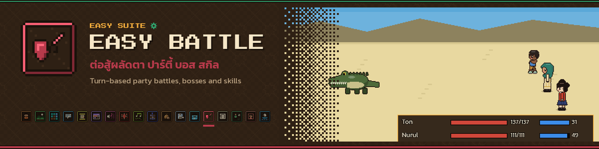
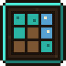
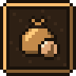
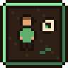
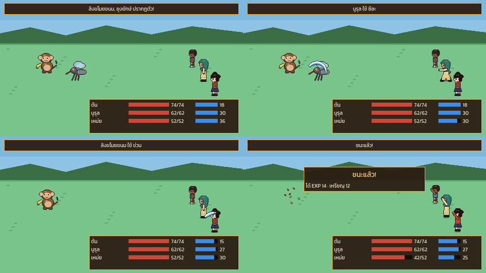
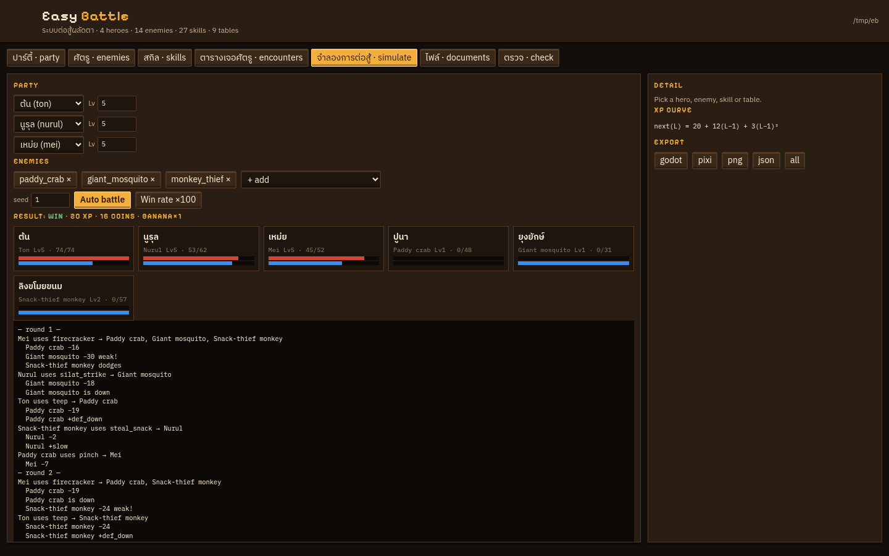

<!-- easy-suite:header:start -->
<p align="center">
  <a href="#easy-suite"></a>
</p>

<p align="center">
  <b>Easy Battle</b> · ต่อสู้ผลัดตา ปาร์ตี้ บอส สกิล · Turn-based party battles, bosses and skills<br />
  <sub>Part of <a href="#easy-suite"><b>Easy Suite</b></a>: Thai-friendly pixel-art game dev tools for Godot 4.3+ and PixiJS v8</sub>
</p>

<p align="center">
  <a href="https://github.com/Saladin2020/easybattle/actions/workflows/ci.yml"></a> <a href="LICENSE"></a>   <a href="docs/MCP.md"></a> 
</p>

<p align="center">
  <a href="https://github.com/Saladin2020/easysprite"></a>
  <a href="https://github.com/Saladin2020/easyscene"></a>
  <a href="https://github.com/Saladin2020/easytilemap"></a>
  <a href="https://github.com/Saladin2020/easydialogue"></a>
  <a href="https://github.com/Saladin2020/easyquest"></a>
  <a href="https://github.com/Saladin2020/easyui"></a>
  <a href="https://github.com/Saladin2020/easysfx"></a>
  <a href="https://github.com/Saladin2020/easyfx"></a>
  <a href="https://github.com/Saladin2020/easymusic"></a>
  <a href="https://github.com/Saladin2020/easyanim"></a>
  <a href="https://github.com/Saladin2020/easyitems"></a>
  <a href="https://github.com/Saladin2020/easysave"></a>
  <a href="https://github.com/Saladin2020/easykit"></a>
  <a href="https://github.com/Saladin2020/easybattle"></a>
  <a href="https://github.com/Saladin2020/easyfont"></a>
  <a href="https://github.com/Saladin2020/easynpc"></a>
  <a href="https://github.com/Saladin2020/easyportrait"></a>
  <a href="https://github.com/Saladin2020/easyship"></a>
</p>
<!-- easy-suite:header:end -->

# Easy Battle

**ระบบต่อสู้ผลัดตาแบบ JRPG · มวยไทย สีลัต ว่าวและประทัด · ศัตรูตามภูมิภาคบนแผนที่โลก**  
Describe a turn-based JRPG battle system in a small JSON format (`easybattle/1`): stats, skills, five elements,
status effects, enemies with drops, encounter tables per Easy Tilemap overworld region, and XP / level curves. Easy
Battle validates it, simulates fights with one deterministic rule set (win rates for balancing), and exports a
**Godot 4.3+** battle scene + `Battle` autoload or a **PixiJS v8** runtime. It plugs into Easy UI (theme), Easy FX
(skill effects), Easy SFX (hits), Easy Items (drops, battle items) and Easy Save (party state). CLI, web editor and
MCP server; local only, no network.

<p align="center"></p>

| Godot `battle_scene.tscn` (Thai, auto battle) | PixiJS demo (Malay, crocodile boss) |
|---|---|
|  |  |

## Starter battles

Three documents that merge into one database, set in the same multicultural southern Thai village as the other
Easy tools:

| Document | Contents |
|---|---|
| `core.easybattle.json` | rules (max level 30, party of 3, XP curve), 5 elements (ไฟ fire, น้ำ water, ดิน earth, ลม wind, สายฟ้า thunder), 8 statuses (poison, sleep, stun, regen, ATK up, guard, armour break, slow), 27 skills, 6 battle items, 4 heroes |
| `bestiary.easybattle.json` | 12 field enemies (paddy crab, giant mosquito, snack-thief monkey, water monitor, cobra, cave bat, wild boar, fighting rooster, scorpion, road bandit, mud blob, runaway kite) and 7 encounter tables for Thai, Malay, Chinese-Thai and rural regions |
| `bosses.easybattle.json` | river-mouth crocodile and highland tiger, with scripted (no-flee) tables |

Heroes are Easy Sprite side-view characters: **ต้น Ton** (Muay Thai: teep, elbow, wai khru buff), **นูรุล Nurul**
(silat and jamu herbal healer, hijab), **เหม่ย Mei** (kites and firecrackers: wind and fire magic), **อาดัม Adam**
(fisher with an oar: water and thunder drum). Battle items and drops are Easy Items ids (balm, teh tarik, kurma,
Thai tea, ketupat, bubur, banana, mango…).

<p align="center"></p>

Content rules: no sacred figures, scripture, Quran or Arabic calligraphy as battle content (`check` rejects names
and descriptions that use them), and places of worship are never battlegrounds or enemies. Martial arts, herbs,
kites, firecrackers and animals are fine.

## Quick start

```bash
npm ci && npm run build
npx easybattle init                                   # battles/ exports/ with the starter database
npx easybattle list enemies
npx easybattle sim --party ton:5,nurul:5,mei:5 --vs wild_boar,monkey_thief --seed 3 --log
npx easybattle sim --party ton:9,nurul:9,mei:9 --vs river_crocodile --runs 100 --items balm:3   # win rate
npx easybattle encounter --culture malay --terrain forest --times 5
npx easybattle bind-overworld path/to/overworld.json  # one table per Easy Tilemap region, harder further out
npx easybattle check --items ../my-items --overworld path/to/overworld.json
npx easybattle render --what bestiary --out bestiary.png --scale 3
npx easybattle export --preset all                    # exports/easybattle-{godot,pixi,png,json}
npx easybattle serve                                  # editor at http://127.0.0.1:8938
```

`xp` prints the level table, `show <id>` one entry (heroes with stats per level), `new-enemy <id> --th --en --art`
writes `battles/game.easybattle.json`. Set `EASYBATTLE_WORKSPACE` or pass `--workspace`.

## Rules in one screen

* **Turn order**: everyone alive sorted by SPD (ties: heroes first, then position). Sleep and stun skip a turn.
* **Damage**: physical `atk × power / 10 − def / 2`, magic `mag × power / 10 − res / 2`, × 0.9–1.1, crit × 1.5
  (6 %), weak × 1.5, resist × 0.5, defend × 0.5, immune 0. Heals use MAG.
* **Statuses** last `turns` rounds: poison / regen tick a % of max HP, `atk` / `def` / `mag` / `spd` multiply a stat.
* **XP**: `next(L) = base + step·(L−1) + quad·(L−1)²` (20 / 12 / 3 by default). Enemies above their base level give
  10 % more XP and coins per level; drops roll per enemy.
* **Encounters**: a table is picked by overworld region id, then culture, then a fallback; `rate` is the average
  number of steps between fights; groups are weighted. Scripted tables (bosses) never roll randomly and cannot be fled.

The TypeScript engine, the Pixi runtime (same code, bundled) and the GDScript port share one seeded mulberry32
sequence. The Godot test replays four scripted battles and 54 encounter rolls and compares canonical JSON with the
TypeScript results.

## Export

| Preset | What you get |
|---|---|
| `godot` | A Godot 4.3+ project: `easybattle/easybattle.gd` autoload **`Battle`** (party, `step(region, culture, ground)` for random encounters, `scripted(table)`, `start(setup, parent, opts)`, rewards into Easy Items' `Items`, `to_dict()` / `from_dict()` for Easy Save), `battle_engine.gd` (`EasyBattleEngine`), `battle_scene.tscn` (command menu, targets, HP / MP bars, damage pop-ups, Easy FX strips, Easy SFX sounds, result panel; Easy UI's `teak.tres` when present), enemy strips, hero sheets, Kanit, `test_battle.gd`, `capture.gd` |
| `pixi` | `easybattle.json`, `easybattle-core.js` (the engine), `easybattle-pixi.js` (`loadBattle(PIXI, url)` → `start(app, setup, {lang, auto})`, `scripted(table, seed)`, `party(level)`), art, fx/sfx, `index.html` demo (`?table=&level=&seed=&lang=&auto`) |
| `png` | `bestiary.png`, `enemies/<id>.png` strips (idle, bob, hurt) |
| `json` | merged `easybattle.db.json` |

```gdscript
# overworld player script (Easy Tilemap overworld)
var setup := Battle.step(region_id, region_culture, ground_code)   # {} or a battle
if not setup.is_empty():
    Battle.start(setup, $BattleLayer, {"lang": "th"})
    var result = await Battle.battle_ended                        # "win" | "lose" | "fled", rewards
```

Easy FX and Easy SFX assets are rendered into the export when those tools are installed (`--no-bundle` skips it;
`EASYBATTLE_EASYFX_CLI` / `EASYBATTLE_EASYSFX_CLI` point at a CLI).

## Web editor

`easybattle serve` (port 8938; `npm run dev` uses Vite on 5193). Tabs: **Party** (heroes with their Easy Sprite
sheets), **Enemies** (art, stats, weaknesses), **Skills**, **Encounters** (tables and live rolls), **Simulate**
(pick a party and enemies, run an auto battle with a readable log, or a 100-seed win rate), **Documents** (edit
JSON, validate against the whole workspace, save) and **Check**. Export buttons for every preset.



## MCP server

`npm run mcp` (stdio) or `npm run mcp:http` (port 8939). Tools: `workspace_info`, `list_entries`, `get_entry`,
`write_battles` (validates against the whole workspace, `dryRun`), `check_battles`, `simulate_battle` (one fight or a
win rate), `roll_encounter`, `render_battle` (returns a PNG) and `export_battle`. See [docs/MCP.md](docs/MCP.md).

## Ports

| | Port |
|---|---|
| Editor + API (`serve`) | 8938 |
| MCP over HTTP | 8939 |
| Vite dev server | 5193 |

The server only answers loopback hosts and same-origin writes (a bearer token is printed once when bound
elsewhere). Paths outside the workspace or `EASYBATTLE_ALLOWED_DIRS` are refused.

## Development

```bash
npm test                                                 # vitest
GODOT=/path/to/godot npx vitest run test/godot.test.ts   # headless Godot parity + scene check
npm run typecheck
npm run smoke                                            # CLI + MCP (stdio and HTTP)
npm run check:pixi -- exports/easybattle-pixi shot.png   # headless Chrome wins a battle with real clicks
node scripts/build-core.mjs                              # after editing src/shared/engine.ts
```

<!-- easy-suite:table:start -->
## Easy Suite


Eighteen small, local-first tools that share one look (teak, lantern gold, Kanit, 16/48px pixels), one
workflow (CLI · web editor · MCP server) and the same targets (**Godot 4.3+** and **PixiJS v8**).
ชุดเครื่องมือทำเกมพิกเซลสไตล์ไทย ใช้ร่วมกันได้ทั้งชุด · the samples share one multicultural southern Thai village.

| | Tool | What it does | Repo |
|:-:|---|---|---|
|  | [**Easy Sprite**](https://github.com/Saladin2020/easysprite) | Compose modular 48px chibi characters (top-down + side-view) and export sheets. | [`easysprite`](https://github.com/Saladin2020/easysprite) |
|  | [**Easy Scene**](https://github.com/Saladin2020/easyscene) | Side-view levels: parallax layers, 16px autotiles, Thai town props. | [`easyscene`](https://github.com/Saladin2020/easyscene) |
|  | [**Easy Tilemap**](https://github.com/Saladin2020/easytilemap) | Top-down 16px maps: blob-47 autotiles, objects, collision, spawns. | [`easytilemap`](https://github.com/Saladin2020/easytilemap) |
|  | [**Easy Dialogue**](https://github.com/Saladin2020/easydialogue) | Branching `.ezd` dialogue with Thai-safe text, portraits and choices. | [`easydialogue`](https://github.com/Saladin2020/easydialogue) |
|  | [**Easy Quest**](https://github.com/Saladin2020/easyquest) | Text `.ezq` quests: steps, flags, items, rewards, linked to dialogue. | [`easyquest`](https://github.com/Saladin2020/easyquest) |
|  | [**Easy UI**](https://github.com/Saladin2020/easyui) | Nine-slice pixel UI kit: panels, bars, inventory, menus, 30 icons. | [`easyui`](https://github.com/Saladin2020/easyui) |
|  | [**Easy SFX**](https://github.com/Saladin2020/easysfx) | Deterministic 8-bit SFX and 4-channel chiptune loops, typing blips. | [`easysfx`](https://github.com/Saladin2020/easysfx) |
|  | [**Easy FX**](https://github.com/Saladin2020/easyfx) | Pixel particles: sparks, fire, rain, lanterns, Raya pelita; sheets + Godot particles. | [`easyfx`](https://github.com/Saladin2020/easyfx) |
|  | [**Easy Music**](https://github.com/Saladin2020/easymusic) | Seeded Thai loop music: ranat, khong wong, saw, khim, pi, kompang; seamless WAV/OGG loops. | [`easymusic`](https://github.com/Saladin2020/easymusic) |
|  | [**Easy Anim**](https://github.com/Saladin2020/easyanim) | Cutscene timelines: actors, camera, dialogue, FX and music cues; Godot + Pixi runners. | [`easyanim`](https://github.com/Saladin2020/easyanim) |
|  | [**Easy Items**](https://github.com/Saladin2020/easyitems) | Item database, shops, inventory, loot tables and crafting; 44 starter items with pixel icons. | [`easyitems`](https://github.com/Saladin2020/easyitems) |
|  | [**Easy Save**](https://github.com/Saladin2020/easysave) | Versioned save slots with migrations and checksums; Thai / English / Malay string tables. | [`easysave`](https://github.com/Saladin2020/easysave) |
|  | [**Easy Kit**](https://github.com/Saladin2020/easykit) | One command drives all 12 tools into a playable Godot 4.3+ and PixiJS game; unified MCP server and `doctor`. | [`easykit`](https://github.com/Saladin2020/easykit) |
|  | **Easy Battle** ← you are here | Turn-based battles: party, bestiary, skills, statuses, bosses; seeded simulator; Godot + Pixi runtimes. | [`easybattle`](https://github.com/Saladin2020/easybattle) |
|  | [**Easy Font**](https://github.com/Saladin2020/easyfont) | Pixel bitmap fonts for Thai, Latin and Malay: stacking vowels and tones, BMFont / TTF for Godot + Pixi. | [`easyfont`](https://github.com/Saladin2020/easyfont) |
|  | [**Easy NPC**](https://github.com/Saladin2020/easynpc) | NPC daily schedules with A* on Easy Tilemap maps, day / night, affinity, dialogue and quest hooks. | [`easynpc`](https://github.com/Saladin2020/easynpc) |
|  | [**Easy Portrait**](https://github.com/Saladin2020/easyportrait) | 64×64 dialogue portraits with 9 emotions, blink and talk frames, from Easy Sprite characters. | [`easyportrait`](https://github.com/Saladin2020/easyportrait) |
|  | [**Easy Ship**](https://github.com/Saladin2020/easyship) | Toolchain doctor, web / Windows / Linux / Android builds, itch.io zips and butler plans; dry run by default. | [`easyship`](https://github.com/Saladin2020/easyship) |
<!-- easy-suite:table:end -->

## Credits

Enemy art and sample data are drawn and written in code and dedicated to the public domain (CC0 1.0); hero sheets
come from Easy Sprite parts (CC0). Kanit is bundled under the SIL OFL 1.1. See [CREDITS.md](CREDITS.md). Code: MIT.
